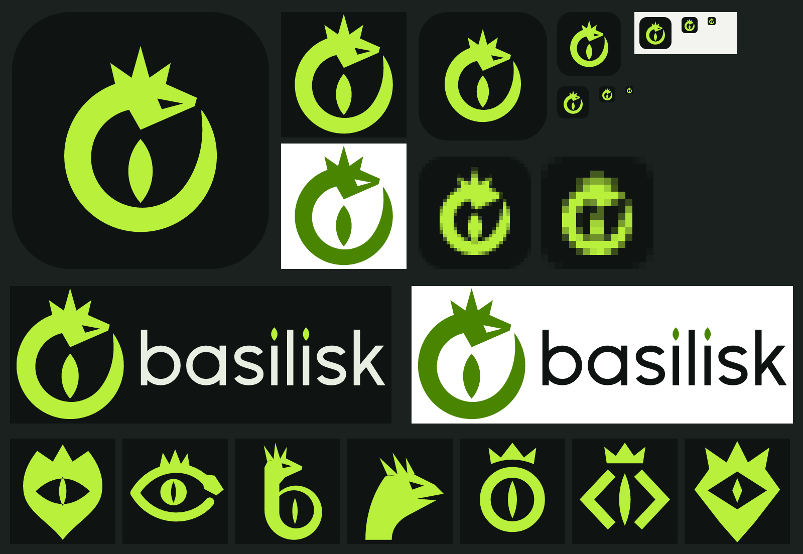

# basilisk brand assets



## The idea

The basilisk is the crowned serpent whose gaze kills. The mark is that
serpent coiled into a ring, and the ring is the iris of an eye: the slit in
the middle is the pupil. A tool that stares into binaries gets an emblem
that is itself a stare. Read small it is an eye with a crown; read large it
is a serpent chasing its tail. The ring and the stroke inside it are also a
0 and a 1.

The body is a perfect circle on the outside and a near-even ring for three
quarters of the way round, then thins into a blade for the tail. The tip of
the crown, the point of the jaw and the pupil sit on one vertical axis
through the centre of the ring, so the mark is symmetrical apart from the
head and the tail. Head, crown, pupil and tail all end in sharp points;
everything else is one circle. In the icon the ring is centred on the tile.

It sits in the same family as Ghidra's dragon (a mythical beast as a flat
emblem, coiled) but shares no shapes, colour or lettering with it: this is
a legless, wingless serpent in green, built from one circle, with an eye in
the middle. It uses no Rust or Ferris artwork.

## Palette

| Name     | Hex       | Use                                             |
|----------|-----------|-------------------------------------------------|
| Venom    | `#B8F03C` | The mark on dark backgrounds; accents           |
| Moss     | `#4A8500` | The mark on light backgrounds (4.5:1 on white)  |
| Obsidian | `#0F1412` | Icon tile, dark backgrounds, wordmark on light  |
| Bone     | `#E9EEE2` | Wordmark and text on dark                       |

Flat colour only. No gradients, glows, outlines or shadows.

## Files

| File                       | Use it for                                                        |
|----------------------------|-------------------------------------------------------------------|
| `basilisk-mark.svg`        | Emblem alone, Venom, transparent. Dark backgrounds (in-app, about box, dark docs). |
| `basilisk-mark-light.svg`  | Emblem alone, Moss, transparent. Light backgrounds.               |
| `basilisk-mark-mono.svg`   | Emblem in `currentColor`. One-colour print, UI glyphs, anything that must inherit the text colour. |
| `basilisk-logo.svg`        | Emblem + wordmark for light backgrounds.                          |
| `basilisk-logo-dark.svg`   | Emblem + wordmark for dark backgrounds.                           |
| `basilisk-icon.svg`        | App icon: emblem on the Obsidian tile. Source for 64 px and up.   |
| `basilisk-icon-small.svg`  | Simplified icon for 16 and 32 px: heavier ring, no head eye, pupil centred on the pixel grid. |
| `png/basilisk-icon-N.png`  | Icon renders at 16, 32, 64, 128, 256, 512, 1024 px (window icon, favicon, bundles). |
| `png/preview-*.png`        | Previews only (mark, both logos, overview sheet). Not for shipping. |
| `concepts/`                | Rejected directions, see below.                                   |

For a README that follows the viewer's theme:

```html
<picture>
  <source media="(prefers-color-scheme: dark)" srcset="assets/brand/basilisk-logo-dark.svg">
  
</picture>
```

The wordmark is drawn as strokes and polygons, so no font is needed. The
dots on the two i's repeat the slit pupil.

## Clear space and minimum size

- Clear space: keep a margin of at least a quarter of the ring's diameter
  on every side of the mark or logo. Nothing else goes inside it.
- Mark: 24 px minimum on screen, 8 mm in print. Below 24 px use the icon
  PNGs (16 and 32 px come from the simplified artwork).
- Logo: 120 px wide minimum on screen, 30 mm in print.
- Icon: 16 px minimum. At 16 px it reads as a crowned ring with a slit; the
  serpent's head only resolves from 32 px up.
- Do not recolour outside the palette, rotate, stretch, outline, or put the
  Venom mark on a light background (use Moss or mono there).

## Editing and re-rendering

The SVGs are plain paths in a 256-unit box. The ring is a circle of radius
100 centred on (128, 148); its outer edge is one arc command and its inner
edge is nine cubic segments. Head and crown are straight-edged polygons and
the pupil is two circular arcs centred on x = 128, all safe to nudge by
hand.

Regenerate the PNGs with [resvg](https://github.com/linebender/resvg):

```sh
cd assets/brand
for s in 16 32;              do resvg -w $s basilisk-icon-small.svg png/basilisk-icon-$s.png; done
for s in 64 128 256 512 1024; do resvg -w $s basilisk-icon.svg       png/basilisk-icon-$s.png; done
```

## Rejected concepts

Kept in `concepts/` so a different direction can be picked up.

- `01-hooded-eye.svg` — a cobra hood seen head-on with one eye in it (the monocled cobra). Bold at 16 px, but reads as a tulip or a heart, not a serpent.
- `02-lidded-serpent.svg` — a serpent as the eyelids of an almond eye. Reads as a stock eye icon with lashes; the head is an afterthought.
- `03-rearing-b.svg` — a rearing serpent that forms a lowercase b, its coil an eye. The runner-up: the most distinct from Ghidra, but more mascot than emblem and a "6" at 16 px.
- `04-profile-head.svg` — a crowned head in profile. The most literal and the most rooster-like; a blob below 32 px.
- `05-crowned-bit.svg` — a 0 and a 1 as iris and pupil under a crown. Clean, but there is no creature in it; it looks like a token. Its eye survived into the final mark.
- `06-bracket-eye.svg` — angle brackets as eyelids around a slit pupil. Looks like every other developer-tool logo, and the crown floats.
- `07-faceted-mask.svg` — a faceted, horned mask with one eye. Strong silhouette, generic menace; nothing says serpent.
