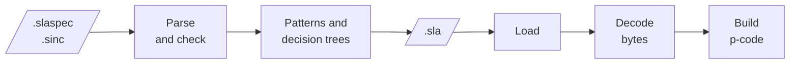

SLEIGH is Ghidra's language for describing instruction sets. One specification says, for every instruction
of a processor, which bits encode it, how it is displayed, and what it does as [p-code](/docs/internals/pcode/).
Basilisk reads Ghidra's specifications unchanged and implements both halves of SLEIGH: the compiler and the
runtime. Both exist today.



## What a specification says

A small piece of a specification, simplified:

```text
define token opbyte (8)
    op  = (4,7)
    reg = (0,3);

:INC reg  is op=0x4 & reg  { reg = reg + 1; }
```

- A **token** is a group of bits read from the instruction, here one byte split into two **fields**.
- A **constructor** (the line starting with `:`) is one way to build an instruction. Its **pattern**
  (`op=0x4 & reg`) says which bit values select it; its **display** (`INC reg`) says how it prints; its
  **semantics** (`{ … }`) say what it does, in p-code.
- Constructors nest. An operand such as `reg` can itself be a **table** of constructors, each with its own
  pattern, display and semantics. That is how a few hundred lines describe addressing modes that combine
  into thousands of instructions.
- **Context variables** are bits that are not in the instruction but change how it decodes: ARM's Thumb
  mode, x86's operand size. Instructions can set them for the instructions that follow.

## Compiling

The compiler turns the specification into tables a decoder can use quickly.

1. **Preprocess, lex, parse** (`bk-sleigh-syntax`): `@define`, `@include` and `@if` are resolved, and the
   text becomes a syntax tree.
2. **Analyse** (`bk-sleigh-compiler`): symbols, tokens and constructors are checked, macros expanded, and
   each constructor's semantics compiled into a p-code **template** — p-code with holes where the operands
   go.
3. **Resolve patterns**: every constructor's pattern becomes a mask and a value over the instruction's
   bits and the context bits.
4. **Build decision trees**: for each table, the compiler builds a tree that tests a few bits at a time
   and ends at the one constructor that matches. Which bits to test first is chosen by a score, so that the
   tree is shallow.
5. **Write the `.sla` file**: symbols, templates and trees in Ghidra's packed format.

The result is compared with Ghidra's compiler for all 150 specifications, and must be equal byte for byte.

## Decoding

To decode an instruction, the runtime (`bk-sleigh`) starts at the root table with the bytes and the current
context:

1. Walk the table's decision tree, testing bits, to the matching constructor.
2. For each operand of that constructor that is itself a table, do the same, recursively. The result is a
   tree of constructors — the instruction's parse.
3. Apply context changes the constructors ask for.
4. Print: walk the tree and emit each constructor's display pieces. That gives the mnemonic and operands.
5. Lift: walk the tree again and fill each template's holes with the operands' values. That gives the
   instruction's p-code. Delay slots pull in the next instruction's p-code here.

Each step is a table lookup, which is why decoding is fast: over a million instructions a second with
p-code on one core.

## In Basilisk

| Crate | Part | State |
|---|---|---|
| `bk-sleigh-syntax` | Preprocessor, lexer, parser | Done: parses all 150 specifications |
| `bk-sleigh-compiler` | Analysis, templates, patterns, decision trees, `.sla` output | Done: byte-equal to Ghidra for all 150 |
| `bk-sla` | The `.sla` file: a validating reader and writers | Done: all 150 files read and written back byte for byte |
| `bk-sleigh` | Loading, the context database, decoding, display, p-code | Done: equal to Ghidra's engine for every language |
| `bk-sleigh-snippet` | The small p-code snippets inside `.cspec` and `.pspec` files | Done: all 137 compile to Ghidra's result |

The `.sla` reader checks every file before use. A file that would make Ghidra's engine read out of bounds
is rejected with an error instead; none of the files Ghidra ships or compiles is affected.

Try it: [`basilisk sleigh compile`](/docs/cli/sleigh-compile/), [`basilisk disasm`](/docs/cli/disasm/).
